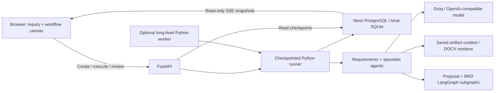
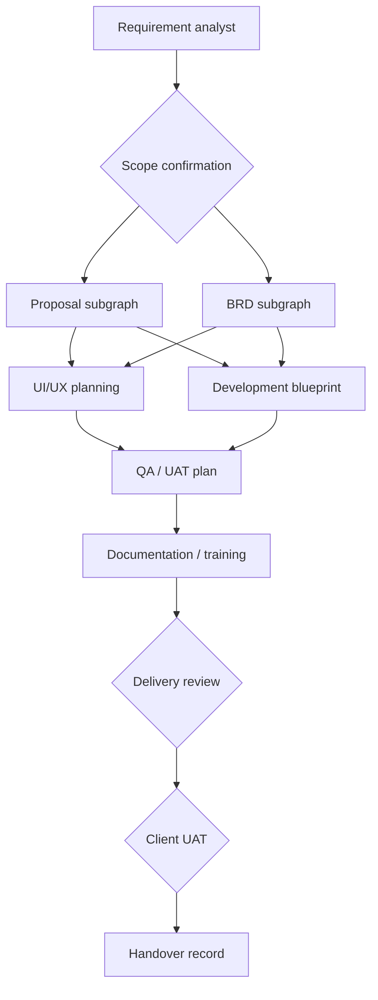

# Wooplix Workflow Studio

## Purpose and scope

Build an internal AI delivery workspace where the team can watch each task,
inspect the source data and resulting documents, resolve human decisions, and
recover interrupted work. The first workflow produces a software delivery
planning pack. An agent-produced plan is not evidence of implemented software,
executed tests, or client acceptance.

The new studio is available at `/workflow`. It provides a node-and-edge canvas,
pan/zoom, draggable layout, input/output inspection, an event log, execution
controls, and reviewed or automatic execution. Graph connections are defined
by the server; dragging a node only changes its local display position.

## Current system architecture



Vercel hosts the FastAPI app and the frontend assets. Neon stores shared project
state. The same runner can execute inside a bounded HTTP wave or a separate
Python worker process. The existing `hello.ts` Neon Function is still a test
function; it does not run the Python workflow.

## Delivery dependency graph



In reviewed mode, human gates stop scheduling until a decision is saved. A
failed UAT reopens UAT and cannot execute handover. In automatic mode the three
human nodes are explicitly **skipped**, not approved, and the result is
`pack_ready`. The handover pack records that implementation and UAT still need
to happen.

## Nested proposal / BRD graph

One analyzed requirement context feeds the document subgraphs. Their supervisor
assigns solution, delivery, commercial and risk specialists in parallel. A
fan-in reconciles typed outputs before a proposal or BRD writer runs. Source
validation and an independent critic check the result. One bounded repair is
allowed before rechecking or rejecting. Successful drafts retain grounding,
quality reports and nested trace data. Word export uses the saved result.

The studio surfaces nested LangGraph start/completion events under each
document node. These events do not yet provide independently resumable nested
checkpoints; retrying a failed document node reruns that document subgraph.

## Execution and data flow

1. Chat/document intake creates a typed brief. `POST /api/runs` saves a queued
   project immediately, before any model call.
2. The canvas subscribes to `GET /api/projects/{id}/events`. A saved event cursor
   supports reconnect/replay without starting work.
3. Execute sends `POST /api/projects/{id}/execute`. The runner atomically claims
   one ready wave with a unique lease token and an optimistic timestamp check.
4. At most two ready agents run in parallel on independent copies of the wave
   input. Node starts, provider mode and nested graph milestones are saved.
5. Each successful result is committed immediately. A failing sibling cannot
   erase a completed artifact. The next wave waits for all required predecessors.
6. An SSE read loop checks for changed snapshots roughly once per second.
   Unchanged versions return no project body from the database. Streams reconnect
   every 25 seconds to stay short-lived on serverless hosting.
7. Human review, cancellation, failures and retry are state transitions. The
   browser inspects saved state after a lost request rather than blindly repeating
   provider calls.
8. The optional worker scans queued projects and executes waves independently
   of the browser. Only the worker deployment makes this unattended execution;
   the browser alone schedules the next HTTP wave while the page is open.

## Persistence and recovery

The existing `automation_projects` JSONB snapshot gains an optional `live_run`
object. No new table migration is required for this version. Legacy projects
remain readable and use their original workflow path.

| Record | Stored information |
| --- | --- |
| Project | Original input, requirements, current artifacts, gates, decisions |
| Live run | Run ID, graph version, node map, lease owner/expiry, event cursor |
| Node execution | Status, attempt, start/end time, duration, input references, output, generation mode, error |
| Event | Monotonic sequence, timestamp, node, attempt, kind, message, safe metadata |
| Attempt history | Prior failed/cancelled/revised node input and output snapshots |

Snapshot compare-and-swap prevents stale writes. Each wave owns a 360-second
lease, renewed about every 10 seconds. A stale worker's results are rejected
after cancellation or lease replacement. An expired lease requires explicit
recovery through Retry. Completed nodes survive retries. Up to three attempts
are allowed for failed/interrupted nodes before starting a corrected new run.
A reviewer rejection is terminal and cannot be bypassed using Retry.

Cancellation is cooperative: it stops further scheduling and fences out late
results, but cannot forcibly cancel an HTTP request already sent to a model
provider. That request may still incur cost. The newest 1,000 events are retained
per project; prior node attempts can grow with revision cycles. This is a
bounded live history, not a full compliance event archive.

## Agent responsibilities and dependencies

| Node | Input | Responsibility / output |
| --- | --- | --- |
| Requirement analyst | Client brief, goals, users, integrations | Requirement IDs, scope categories, clarification questions |
| Scope review | Requirements, open questions | Recorded human scope decision; skipped in automatic mode |
| Proposal | Analyzed scope and client answers | Grounded proposal, assumptions, quality report |
| BRD | Same analyzed scope | Business/functional requirements and traceability |
| UI/UX | Requirement register plus proposal/BRD context | Journeys, screen/state specification, accessibility guidance |
| Development | Requirement register plus upstream documents | Architecture proposal, backlog and API/quality-gate plan |
| QA/UAT | Design and implementation planning | Requirement-linked scenarios and release criteria |
| Documentation | Saved BRD, UI/UX, implementation and QA artifacts | Requirement-linked user guidance, proposed technical reference, support triage, training practice, and explicit verification tasks |
| Delivery review | Generated planning pack | Approval, rejection or revision instruction |
| Client UAT | Test plan and external test evidence | Human pass/fail decision; tests are not executed by this node |
| Handover | Current artifacts and review outcome | Saved handover record or unapproved automatic planning pack |

The standalone Security Agent and model-powered top-level Supervisor are not
implemented as executable nodes. A solution specialist and quality critic are
active inside live Groq proposal/BRD subgraphs. Tool names in the registry are
descriptive contracts, not bound GitHub, Figma or Playwright connectors.

## Key technology and service dependencies

| Dependency | Current role / configuration |
| --- | --- |
| Python 3.14 (project minimum 3.12) | Application runtime; pinned deployment version |
| FastAPI / Uvicorn / Pydantic | HTTP endpoints, SSE responses, request/state validation |
| Neon PostgreSQL + psycopg | Durable shared snapshots; `DATABASE_URL` uses the pooled endpoint |
| SQLite | Local development and isolated tests; cannot support reliable multi-instance Vercel runs |
| LangGraph | Nested proposal and BRD specialist graphs; top-level runner is explicit Python |
| Groq SDK | Live document graph when `GROQ_API_KEY` is set and `PROPOSAL_ENGINE=auto` or `langgraph` |
| OpenAI-compatible API | Optional hints/intake; an OpenAI-only key does not activate the imported Groq graph |
| HTML / CSS / JavaScript / SVG / EventSource | Current zero-build canvas and live node inspector |
| python-docx / pypdf / multipart | Saved Word exports and requirements-document extraction |
| Separate Python worker host | Required to keep scheduling after users close the browser; provided entrypoint, not provisioned |
| Playwright / Pillow | Development-only browser checks and architecture diagram generation |

Use `DATABASE_URL_UNPOOLED` for future schema migrations, not application request
traffic. Hosting supplies `VERCEL`; never upload local env files as application
source. `NEON_AUTH_*` values currently do not authenticate this FastAPI app.

## What to build next (ordered roadmap)

### 1. Staff access and workspace authorization

Integrate the existing Neon Auth service into the UI and validate identity at
every project, event, artifact, download and decision endpoint. Add workspace
membership and reviewer/operator/admin permissions. Retain deployment-level
protection until these checks are deployed and tested.

### 2. Unattended durable execution

Host the Python worker on a persistent container/service with the same Neon
database. Add queue indexes, heartbeat observability, graceful shutdown and
scheduled recovery policies. Adopt a single durable scheduling system (for
example Temporal) when workflow volume and side effects justify it. Use
LangGraph PostgreSQL checkpoints inside document subgraphs so retries resume
failed specialists instead of regenerating a whole document.

### 3. Strict model reliability and budgets

Record actual provider latency, token/cost usage and all fallback reasons.
Enforce total run deadlines, permitted models and spend limits. Add a strict
generation mode and company-specific evaluation cases. Current template/hint
agents can still succeed with a visible fallback; that is not model success.

### 4. Versioned visual workflow authoring

Introduce validated graph definitions, node types, port schemas, cycle checks,
branch conditions, immutable published versions and parameter editors. Keep
execution state separate from editable definitions. React + TypeScript + React
Flow is a suitable next UI stack once reusable node editing is required; a
canvas layout change must never silently change business dependencies.

### 5. Executable business tools

Add a GitHub App with per-repository permissions, isolated branches, patches,
tests and reviewable pull requests. Add executable Playwright/CI tests, preview
deployments and stored evidence. Then connect Figma, Linear/Jira, Slack and file
storage based on actual team needs. Give each tool a typed input/output contract,
idempotency key and independently verified outcome.

### 6. Storage, visibility and release quality

Normalize run/task/event tables with indexed queues and pagination before scale.
Store large files in object storage. Add Sentry and one tracing platform such
as Langfuse or LangSmith. Track pass rates, repeat calls, cost, human corrections
and actual elapsed delivery time. Treat the earlier 500-to-40-hour goal as an
experiment, not a measured capability.

## Current limitations

- This is a fixed delivery workflow viewer/runner, not a general n8n connector
  marketplace or arbitrary drag-to-connect automation builder.
- The UI is custom JavaScript/SVG, not yet Next.js or React Flow.
- No application login, tenant isolation or per-project authorization exists.
- No generated application code is executed or deployed by the planning agents.
- Node input panels show source/input references and version IDs; they are not
  complete model prompt/token traces. Nested events expose milestones and output
  field names, not a separately resumable nested execution.
- Browser-driven waves are not unattended jobs. Closing the tab stops scheduling
  later waves; an in-flight request may finish or be terminated by the host.
- A single long proposal/BRD subgraph can still exceed Vercel's 300-second limit.
  A lease enables recovery after expiry, but does not remove the hosting limit.
- Events are polled from stored snapshots and streamed approximately every second;
  this is task-level progress, not token-by-token model streaming.
- Snapshot writes duplicate project content; event/attempt growth and list-all
  project queries need normalization/pagination for larger teams.
- Rate-limits, cost budgets, scheduled triggers and automatic recovery are not
  fully implemented. Live cloud model quality/latency require separate evaluation.

## Local operation and verification

```bash
DATABASE_URL='' GROQ_API_KEY='' OPENAI_API_KEY='' ./scripts/start.sh
# Open http://127.0.0.1:8000/workflow

# Optional separate worker, using the same environment and database as the API:
.venv/bin/python -m scripts.worker

.venv/bin/python -m unittest discover -s tests -v
.venv/bin/python -m scripts.browser_flow_smoke
.venv/bin/python -m scripts.export_architecture
```

For serverless live runs, `POST /api/runs` refuses to use ephemeral SQLite and
requires Neon. No production migrations, deployment or credentials changes
are performed by the architecture exporter or offline tests.

## Source map

- `app/live.py`: graph selection, lease claims, execution waves, retry/cancel,
  gate transitions and per-node inspection.
- `app/models.py`: persisted run/node/event contracts.
- `app/storage.py`: shared snapshot CAS and changed-version reads.
- `app/progress.py`: execution-local callback for model/subgraph milestones.
- `app/proposal_integration.py`: nested LangGraph progress and quality acceptance.
- `app/main.py`: queue, execution, SSE and inspector endpoints.
- `app/static/flow.html`, `flow.css`, `flow.js`: visual studio.
- `scripts/worker.py`: standalone worker entrypoint.
- `tests/test_live.py`: concurrency, replay, recovery, cancellation and gate tests.

## Live API contract

| Endpoint | Purpose |
| --- | --- |
| `POST /api/runs` | Queue a live run and return its ID immediately |
| `GET /api/live/topology` | Read the actual fixed execution graph |
| `GET /api/projects/{id}/flow?after=N` | Read node states and events after a cursor |
| `GET /api/projects/{id}/events` | Read-only SSE stream; supports `Last-Event-ID` |
| `GET /api/projects/{id}/nodes/{node}` | Inspect input references, output, events and prior attempts |
| `POST /api/projects/{id}/execute` | Claim and execute one ready wave |
| `POST /api/projects/{id}/retry` | Recover failed/interrupted nodes; retain successful outputs |
| `POST /api/projects/{id}/cancel` | Stop scheduling and fence out late results |
| `POST /api/projects/{id}/gates/{gate}/respond` | Resolve the active human decision |

Legacy `/api/projects` creation remains synchronous for compatibility. New UI
creation routes to `/api/runs` and immediately opens Workflow Studio.
